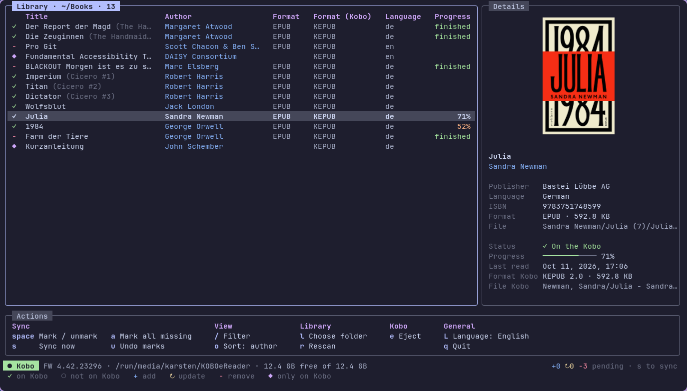

<h1 align="center">kobosync</h1>

<p align="center">A lightweight terminal app to sync your EPUB and PDF library to a Kobo eReader.</p>

<p align="center">
  
</p>

EPUBs are converted to KEPUB on the way, using [kepubify](https://github.com/pgaskin/kepubify)
as a library, so there is nothing else to install. PDFs are copied as they are.

- Detects the Kobo as soon as it is plugged in and mounts it through udisks
  if nothing else does (like Calibre or a desktop automounter would)
- Matches library and Kobo by metadata (ISBN, identifiers such as Calibre's
  UUID, title + author), so renamed files and books Calibre sent (even PDFs it
  converted to EPUB) are recognised
- Reads Calibre libraries: uses `metadata.opf` and `cover.jpg` and shows a
  book with several formats once (EPUB is preferred for the Kobo over PDF)
- Shows title, author, series, publisher, language, ISBN, the format in the
  library and on the Kobo, and the cover (via the Kitty graphics protocol,
  e.g. in Ghostty or Kitty)
- Reads reading progress from the Kobo database (read only)
- Unmarking a book removes it from the Kobo on the next sync

## Build

```sh
go build -ldflags "-s -w" -o kobosync .
```

## Use

```sh
./kobosync ~/Books
```

| Key | Action |
| --- | --- |
| `space` | Mark / unmark the book for the Kobo |
| `a` | Mark all books that are missing on the Kobo |
| `s` | Sync (asks before doing anything) |
| `u` | Discard pending changes |
| `/` | Filter |
| `o` | Change sort order |
| `L` | Switch interface language |
| `l` | Choose library folder |
| `r` | Rescan |
| `e` | Eject the Kobo so it imports new books |
| `q` | Quit |

Status icons: `✓` on Kobo · `○` not on Kobo · `+` will be added ·
`↻` changed in library, will be updated · `−` will be removed · `◆` only on the Kobo

## Files

- Config: `~/.config/kobosync/config.toml` (`library`, `kobo_dir`, `mount`, `language`)
- Label files: English and German are built in
  ([`internal/i18n/locales`](internal/i18n/locales)). Put `<code>.toml` files into
  `~/.config/kobosync/locales/` to add a language or override single labels;
  missing labels fall back to English.
- Metadata cache: `~/.cache/kobosync/metadata.json`
- On the Kobo, books go into `Books/` (mirroring your library folders), and
  `.kobosync.json` records which library file each synced book came from.
